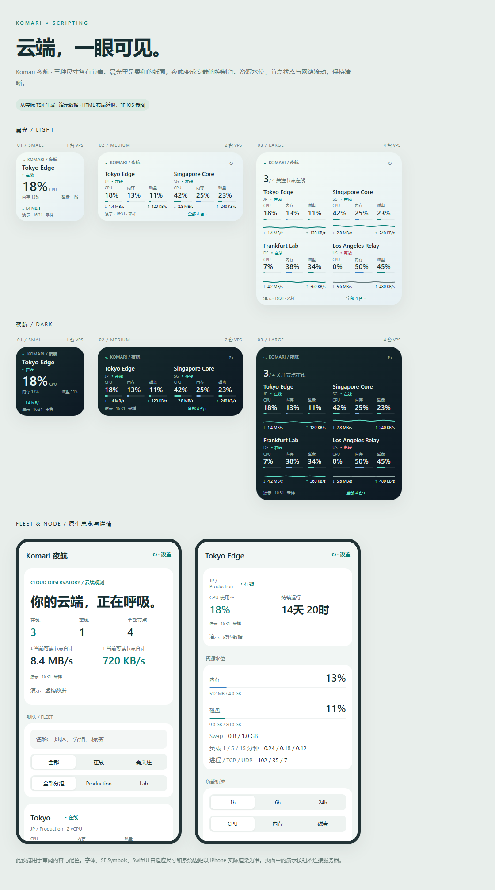

# Komari 夜航

为 iOS **Scripting** 制作的 Komari VPS 监控脚本。包含小、中、大号主屏幕组件，打开脚本进入全部 VPS 总览，点节点进入原生详情。配色随系统深浅色自动切换：浅色用纸面白、雾青与蓝色，深色用墨蓝和薄荷绿。没有远程字体、图片或主题依赖。



## 安装

1. 下载 [Komari-Nightflight.scripting](dist/Komari-Nightflight.scripting) 的原始文件。
2. 在 iPhone 文件 App 中「分享 → Scripting」导入，打开 **Komari 夜航**。
3. 首次使用演示模式，所有节点和数字均为虚构。在「设置」中可预览小、中、大组件。
4. 关闭演示，填写 Komari **HTTPS 站点地址**，例如 `https://komari.example.com`；部署在子路径时填写 `https://example.com/komari`。不要包含 `/api`。
5. 公开站点的 API Key 可留空；私有站点填写 Komari 后台的 API Key，**不是 Agent Token**。点击「读取节点」。
6. 分别选小、中、大尺寸，勾选想显示的 VPS，然后「保存设置」。勾选顺序就是显示顺序。未勾选时按服务器排序选择前几台。
7. 主屏幕添加 Scripting 小组件，选择 **Komari 夜航**，按需要选择尺寸。

也可 [下载完整源码](dist/Komari-Nightflight-source.zip)，将根目录运行时 `.ts` / `.tsx` 与 `script.json` 放入 Scripting 项目。安装包是 ZIP 容器，根目录直接放这些文件，没有外层目录。

## 三个尺寸

| 尺寸 | VPS 数量 | 内容与交互 |
|---|---|---|
| 小号 | 1 | 名称、状态、大号 CPU 读数、内存、磁盘、下载速度、采样时间；点整个组件打开全部监控 |
| 中号 | 1–2 | 每台 CPU／内存／磁盘和上下行；单台显示 CPU 轨迹；点节点查看详情，点顶部／底部打开全部 |
| 大号 | 1–4 | 关注节点在线数、资源水位、CPU 轨迹、上下行；3–4 台采用两列；节点与全部入口分开 |

右上角刷新按钮（中、大号）使用官方 App Intent：先读取数据，再请求组件刷新。小号保持整体点击区域。未选择节点时不会随机替换已失效的选择，会提示重新配置。

**每个主屏幕组件可以独立选择 VPS：** 长按组件 → 编辑 → 参数，填写 UUID，逗号分隔，例如 `uuid-a,uuid-b`。参数覆盖设置内该尺寸的默认选择，按尺寸截取前 1／2／4 台。UUID 在详情机器档案中查看。参数只放 UUID，不放地址或凭证。脚本改名后链接仍使用当前 `Script.name`。

## 总览与详情

- 总览展示当前凭证可见的全部节点，支持名称／地区／分组／标签搜索、分组选择、在线筛选和「需关注」筛选。
- 「需关注」包含非在线状态、CPU ≥ 80% 或内存 ≥ 85% 的节点；把异常状态排在前面。
- 当前可读节点网速合计仅汇总新鲜在线／近期上报节点，未知和旧快照不会当成 0。
- 详情展示资源水位、Swap、1／5／15 分钟负载、运行时间、进程、TCP／UDP、上下行与累计流量。
- CPU／内存／磁盘曲线可切换 **1／6／24 小时**，按真实采样时间绘制，最多 240 点。服务器未启用历史记录时明确显示无数据。
- 新版 RPC 提供的 Ping 汇总展示任务名称、最近有效延迟、平均延迟和丢包率。
- 机器档案包含 CPU、核心数、系统、架构、内核、虚拟化、到期提醒、价格周期、UUID 和公开备注。
- 若接口提供周期计费流量，按服务器 `sum/max/min/up/down` 配置显示流量额度。未提供时显示未知，**不把网卡累计流量当作计费流量**。

## 刷新与状态语义

总览／详情页可见时每 **30 秒**读取，也可手动或下拉刷新；离开页面停止轮询，丢弃离开后返回的请求。组件默认申请 **15 分钟**后刷新，可设置 5／15／30／60 分钟，最终时机由 iOS WidgetKit 决定，不是实时秒级监控。

状态来自采样时刻：新版 RPC 有权威 `online` 字段；超过 2 分钟未上报显示「上报过期」。旧版 REST 没有 HTTP 在线名单，只显示「近期上报／上报过期」，不推断在线或离线。RPC 在线计数不会计入旧版近期上报；总览会显示其他状态的数量。

网络失败保留原成功时间和旧数据，标记「旧快照」，在线数显示 `—`。缺失读数为 `—`，真实 0 为 0。组件本身冻结在某次采样，不能在两次系统刷新之间重新判断当前在线状态；应结合页脚时间查看。CPU 小曲线来自 Komari recent 记录，而非生成的假趋势。

## 接口与版本

优先向站点 `POST /api/rpc2` 发送只读 JSON-RPC 方法：

- `common:getNodes`：可见节点信息。
- `common:getNodesLatestStatus`：全部或选中节点状态。
- `common:getNodeRecentStatus`：组件最近趋势。
- `common:getRecords`：详情历史，使用后端确认的 `maxCount` 参数与按 UUID 分组的 `records`。

RPC 端点不存在（404／405）或节点方法不存在（-32601）时兼容 `GET /api/nodes`、`GET /api/recent/:uuid`、`GET /api/records/load`。鉴权、网络和服务器故障不触发盲目降级。旧版节点读取最多 4 个并发；无法读取个别节点时保留其他节点。API Key 的可用性和隐藏节点范围以部署版本及后端授权为准。没有使用管理员写入接口，也不执行远程命令。

按 2026-10-10 检查的 Komari 源码开发，固定提交 [`e48aa1e`](https://github.com/komari-monitor/komari/tree/e48aa1e76931132fb5dc93ce53763dd59df83d9f)。REST 兼容路径对照该提交保留的接口；没有声称所有历史版本都经过实机验证。

## 本机数据

地址、节点选择和展示快照存于当前脚本私有 Storage；API Key 按完整站点地址绑定，使用 Keychain `first_unlock_this_device`、关闭同步。切换地址不把旧站点凭证发送给新站点。空白保留该地址已存凭证；要切换公开访问，使用「移除已保存站点的凭证和缓存」。不要导出本机钥匙串。

只缓存展示字段；原始节点 Token、IP、私有备注不进入快照。请求拒绝重定向，请填写最终 HTTPS 地址。错误文本不直接显示服务端响应中的潜在凭证。重启设备后首次解锁前组件可能无法读取 Keychain。

## 验证与设计来源

见 [VERIFICATION.md](VERIFICATION.md) 的自动验证与实机检查清单。**尚未在真实 iPhone／Scripting 上执行，尚未连接真实 Komari 服务器，也没有设备同步的官方 `scripting.d.ts`。** 浏览器预览是从 TSX 视图树生成的设计近似，不是 SwiftUI 截图。

视觉参考 [Emerald](https://github.com/Tokinx/komari-theme-emerald) 的资源分层、状态点和信息密度，但布局、配色、原生组件及交互独立实现；没有复制其模板、样式、图标或代码。

官方参考：[Scripting 开发指南](https://github.com/ScriptingApp/scripting-app-development)、[文档索引](https://scriptingapp.github.io/llms.txt)、[Widget API](https://scriptingapp.github.io/guide/Widget/Widget%20API)、[NavigationLink](https://scriptingapp.github.io/guide/Views/Navigation/NavigationStack/Use%20with%20NavigationLink)、[LineChart](https://scriptingapp.github.io/guide/Views/Charts/LineChart/)、[AppIntent](https://scriptingapp.github.io/guide/AppIntent)、[Keychain](https://scriptingapp.github.io/guide/Device%20Capabilities/Keychain)、[fetch](https://scriptingapp.github.io/guide/Utilities/Request/fetch)。

## 开发

Node.js 20+（本次验证使用 Node 24），在本目录执行：

```sh
npm ci
npm test
npm run check
npm run typecheck:core
node tools/preview.cjs
npm run package
```

`typecheck:core` 对独立数据模型和网络客户端做严格检查；`check` 对所有运行时文件做语法诊断，未使用虚构 host 声明冒充官方类型验证。后续实机联调可使用官方 `scripting-cli` 同步当前 app 的 `.d.ts` 再验证全部 TSX。
