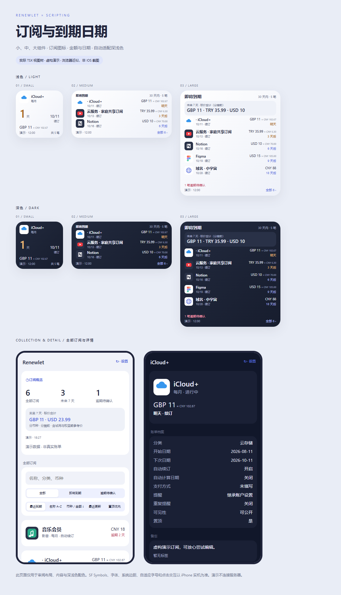

# Renewlet 续订手札

为 iOS **Scripting** 编写的 Renewlet 原生客户端。小、中、大号主屏幕组件显示即将续订、试用结束或权益到期的订阅；打开脚本是全部订阅。支持排序记忆、搜索、筛选、详情、添加与编辑，随系统自动切换深浅色。1.2.0 修正长条组件左对齐，加入中文分类、CNY 参考换算并改进图标读取。



## 安装

1. 下载 [Renewlet.scripting](dist/Renewlet.scripting) 的原始文件。
2. 在 iPhone 文件 App 中「分享 → Scripting」导入，打开 **Renewlet 续订手札**。
3. 首次为明确标记的虚构演示账本，可以放心尝试添加、编辑、排序与组件预览。演示修改只存于本机，设置中可恢复。
4. 打开「设置」，填写 Renewlet **HTTPS 站点地址**，例如 `https://renewlet.example.com`。子路径部署可填写 `https://example.com/renewlet`；不要加 `/api`。
5. 选择连接方式，保存连接；确认账本时区与 Renewlet 账户一致。
6. 在主屏幕添加 Scripting 组件，选择本脚本和小／中／大尺寸。

也可下载 [完整源码包](dist/Renewlet-source.zip)。安装包是 ZIP 容器，运行时文件和 `script.json` 在根目录，没有外层目录。

## 两种连接方式

- **Public API · 只读**：在 Renewlet 设置中创建 `rlt_…` Token，点击「输入 Token 并保存连接」。支持全部订阅、详情和组件；添加与编辑按钮禁用。上游 Public API 不具备写入权限。
- **登录会话 · 添加 / 编辑**：选择登录模式后，在页面直接填写邮箱和「登录密码」，再点击「登录并保存连接」。1.1.1 使用原生 `SecureField`，不再依赖登录密码弹窗；密码提交时清空，切换模式或离开页面也清空。支持 TOTP 身份验证器或恢复码的两步验证。密码不持久化；只保留服务端签发的 Session Cookie、CSRF Cookie 与过期时间。

已连接后，修改窗口和时区可选「保存偏好（保留本站已有凭证）」，不用重输密码。切换地址或模式不会复用其他站点的凭证。会话过期、改密或被撤销后，请重新登录。

**Turnstile 挑战与 Passkey 登录尚未嵌入原生表单。** 这类站点可以使用只读 Token 查看组件与详情，并通过页面的「打开 Renewlet 网页」入口管理订阅。普通邮箱密码 / TOTP 站点可直接在脚本内添加和编辑。

## 三个组件

| 尺寸 | 展示                                                                             | 点击                                 |
| ---- | -------------------------------------------------------------------------------- | ------------------------------------ |
| 小号 | 最近一笔的图标与名称，左侧倒计时、右侧日期与事件类型，下方金额、周期和窗口内笔数 | 整个组件打开全部订阅                 |
| 中号 | 最多 3 笔完整列表，每笔显示图标、名称、日期、事件类型、金额与剩余时间            | 项目打开详情，顶部和「全部」打开列表 |
| 大号 | 最多 5 笔；高度 ≥370 pt 可显示 6 笔，附未来 7 天分币种标价合计与逾期笔数         | 项目打开详情，顶部和「全部」打开列表 |

组件固定按日期从近到远排列，不受主列表排序影响。设置可选择未来 **7／14／30／60／90 天**。仅纳入进行中或试用中的未来项目，试用优先使用试用结束日期；永久买断、已暂停、已取消和已到期记录不占用组件。逾期待确认的记录在主列表单独筛选。

1.1.0 重构了三个组件、列表概览和详情。浅色使用白与浅灰蓝，深色使用墨蓝；今天和 3 天内的时间用琥珀色。界面只保留订阅数据和功能说明，移除口号与倒计时进度条。小号将倒计时与日期分列，利用两侧空间。

## 订阅图标

组件、全部列表与详情均展示 Renewlet 返回的 `logo`，保留原色；白色 SVG 图形使用深色圆角底板，其余使用白色底板。支持外部 HTTP(S) 图片、静态自包含 SVG，以及登录模式下的 `/api/app/assets/:id` 私有上传图标（相对或同站绝对地址，含子路径部署）。PNG／JPEG 使用原生 `UIImage` 解码，缩略图生成失败时保留可解码的原图；其他位图格式以设备能力为准。

私有上传图标从你的 Renewlet 站点读取，需要 Session Cookie，上游不接受 Public API Token。外部图片与最多 4 次重定向不发送账户凭证、清空重定向 Cookie；私有图标不跟随重定向，HTTPS 不降级 HTTP。图标请求使用 5 秒超时、接受不超过 2 MiB 的文件。SVG 支持简单 class／id 样式和内联样式转为绘图属性，移除标准 DTD，拒绝脚本、实体、外部资源及不支持的复杂样式，代码上限 256 KiB。

ChatGPT / OpenAI 在缺失或网络失败时使用包内离线品牌图标。其他没有图标或加载失败的项目显示名称首字。**Renewlet 0.3.30 没有任意外链图片代理接口**：若外部图片在设备网络不可达，请在 Renewlet 网页将该订阅图标改为上传文件，再用登录模式同步；脚本会从本站读取它，不能自动把远程图片变成本站资源。

图标按连接身份隔离缓存，最多 80 个，7 天后尝试刷新；断网保留已有图标，保存连接或退出后清空。组件在呈现前加载可见项目；列表先显示数据，后台预取前 40 笔，其他行出现时按需加载。演示账本的图标是包内示意 SVG，不产生外部图片请求。

每约 **30 分钟**申请一次刷新，最终时机由 iOS WidgetKit 决定。保存设置或订阅后会请求刷新；不是实时倒计时。组件显示上次采样的日期判断与更新时间；跨午夜后以实际刷新为准。

## 分类与参考换算

内置分类使用 Renewlet 的中文名称（例如 `cloud_storage` →「云存储」、`ai_tools` →「AI 工具」）。登录后读取本站自定义分类的 `zh-CN` 名称；选择器显示中文，保存仍提交原始分类值，未知自定义值保留。搜索同时匹配中文名称和原始值。

外币标价后紧跟小字 **`≈ CNY xx.xx`**，CNY 本币不重复显示换算。与 Renewlet 相同的公共汇率源：jsDelivr 的 `@fawazahmed0/currency-api`，不可用时尝试 `latest.currency-api.pages.dev`；匿名请求，不发送账单或凭证。按 USD 基准交叉换算到 CNY，保留两位小数，每 24 小时更新，断网沿用最近成功的汇率；详情记录区显示源日期，未知币种或无缓存显示 `≈ CNY —`。演示账本只用明确标记的虚构汇率且不联网。换算不改变原币种、保存字段、排序或分币种汇总。

## 全部订阅与编辑

- 打开默认是全部订阅，保留所有状态。支持名称／分类／币种搜索，全部／即将到期／逾期待确认筛选。
- **最近到期、名称 A–Z、币种 / 金额降序、最近更新、置顶优先**，排序写入脚本私有 Storage，关闭后仍保留。不同货币按币种分组排序，不进行隐式汇率换算。没有待办日期的记录排在日期排序末尾。
- 点订阅查看完整详情：金额周期、状态、日期、续订设置、提醒、支付方式、网站、备注、标签、可见性、记录 ID、更新时间与家庭分摊概要。
- 登录模式可添加／编辑名称、价格、币种、分类、状态、常见或自定义周期、一次性固定权益期、开始与下次日期、自动续订、自动日期计算、试用截止、支付方式、网站、标签、提醒天数和备注。
- 编辑先读取最新完整详情，保存前再检查是否已被其他设备修改。只 PATCH 改动的表单字段，保留未修改的 Logo、家庭分摊、置顶、公开可见性、重复提醒和 `extra`。高级配置可在网页管理。
- 保存时会显示本次名称／标价与保存位置，再确认提交。若新增请求发生网络中断，可能存在「服务器已保存但响应未收到」的情况，请先回列表刷新确认，避免重复新增；没有自动重试写入。
- 自动日期计算以服务端返回为准。提醒天数 `-2` 静默、`-1` 继承、`0` 当天；通知由 Renewlet 发送，本脚本不额外注册本地通知。

「未来 7 天」汇总是窗口内每个项目**下一次事件的总标价**，包含试用与固定权益期参考，按币种分别精确相加，不是已付款、重复续费预测、个人分摊净额或实际扣款承诺。`autoRenew` 标记也不代表已经支付。

## 数据、网络与版本

凭证按完整站点地址和连接模式绑定，使用 Scripting 全局 Keychain 的 `first_unlock_this_device`，关闭同步。列表缓存、演示账本与偏好存于当前脚本私有 Storage。密码只在登录调用期间使用，不进 Storage、日志或分发包。重启设备后首次解锁前组件可能无法读取凭证。

使用官方 `fetch`：手动处理 `response.cookies`，请求带 Session Cookie，写入附带 `X-Renewlet-CSRF` 与同站 `Origin`；拒绝重定向，使用 15 秒超时。错误消息来自本地固定文案，不回显服务器的潜在敏感响应。网络失败保留完整旧快照和原成功时间，并标记「旧快照」。成功写入更新该笔缓存；不会把未完成分页误当成全部订阅。

对照上游 **Renewlet 0.3.30** 源码提交 [`cf67d13a4a3e05a132ae211fdc31a88305d64544`](https://github.com/zhiyingzzhou/renewlet/tree/cf67d13a4a3e05a132ae211fdc31a88305d64544) 开发，使用 Docker 与 Worker 共享的产品 API 契约：

- 只读：`GET /api/public/v1/subscriptions`（完整游标分页）、`GET /api/public/v1/subscriptions/:id`。
- 会话：`POST /api/app/auth/login`、`POST /api/app/auth/mfa/verify`、`POST /api/app/auth/logout`。
- 登录账本：`GET /api/app/subscriptions`（完整游标分页）、`GET /api/app/subscriptions/:id`、`POST /api/app/subscriptions`、`PATCH /api/app/subscriptions/:id`。
- 中文自定义分类：`GET /api/app/custom-config`（仅登录会话）。
- 私有图标：`GET /api/app/assets/:id`（仅登录会话）。

产品 API 是上游内部契约，后续版本可能变化，未声称兼容所有旧版／分支。更新脚本时请对照 [上游源码](https://github.com/zhiyingzzhou/renewlet) 和 [Public API](https://github.com/zhiyingzzhou/renewlet/blob/main/docs/public-api.md)。参考来源与 MIT 许可见 [ATTRIBUTION.md](ATTRIBUTION.md)。

## 验证与开发

见 [VERIFICATION.md](VERIFICATION.md)。自动测试、核心模型／客户端严格类型检查、全部运行时文件语法检查和浏览器深浅色布局检查通过。官方公开演示站的登录、列表分页、详情读取、退出已验证，未向演示站写入订阅。

**尚未在真实 iPhone / Scripting 执行，未获得设备同步的官方 `.d.ts`，也未连接用户私有站点验证真实写入。** 浏览器预览是实际 TSX 视图树的 HTML 近似，不能替代 SwiftUI 主屏幕验证。

```sh
npm ci
npm test
npm run check
npm run typecheck:core
npm run preview
npm run package
```

Node.js 20+；运行时不依赖 npm 包。类型检查覆盖独立模型、客户端和展示数据计算，不使用伪造 Scripting 声明冒充原生类型验证。真机联调可使用官方 [scripting-cli](https://www.npmjs.com/package/scripting-cli) 同步 app 当前声明后检查所有 TSX。

官方依据：[Scripting 开发指南](https://github.com/ScriptingApp/scripting-app-development)、[LLM 文档索引](https://scriptingapp.github.io/llms.txt)、[Widget API](https://scriptingapp.github.io/guide/Widget/Widget%20API)、[fetch](https://scriptingapp.github.io/guide/Utilities/Request/fetch)、[Response / Cookie](https://scriptingapp.github.io/guide/Utilities/Request/Response)、[Keychain](https://scriptingapp.github.io/guide/Device%20Capabilities/Keychain)、[Storage](https://scriptingapp.github.io/guide/Utilities/Storage)、[DatePicker](https://scriptingapp.github.io/guide/Views/Controls/DatePicker/)。
